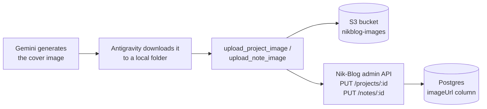

# nikblog-image-mcp

A real MCP (Model Context Protocol) server that closes the last manual step in how I get a cover image onto Nik-Blog. Started 2026-10-21. In progress — I'm writing the code myself, not having it written for me, so this README tracks what's actually built as it gets built, not what's planned.

## The problem this solves

Right now, giving a project or note a cover image means: write a Gemini image prompt by hand, generate it in Antigravity, download the file, open the Nik-Blog admin panel, and upload it manually through the form. That last step is the only one that doesn't need to be manual — Antigravity (which already runs on Gemini models) can call a tool directly instead of me doing the upload by hand every time.

## What it will do

Four tools, each doing one job:
- `list_projects` — titles + ids + whether each already has an image
- `list_notes` — same, for notes
- `upload_project_image(project_id, local_image_path, overwrite=False, confirmed=False)` — reads the file, uploads it to S3, then sets that project's `imageUrl` directly through Nik-Blog's own admin API. Refuses to replace an existing image unless `overwrite` is explicitly `True`. Two-step: a call with `confirmed=False` only previews what would happen — nothing uploads until a second call with `confirmed=True`.
- `upload_note_image(note_id, local_image_path, overwrite=False, confirmed=False)` — same, for notes.

No manual copy-paste of a URL anywhere in this flow — the last step (authenticating to Nik-Blog's admin API and writing the image URL to the database) happens inside the tool, not by me.

## Why it's designed this way

- **A local file path, not base64.** Antigravity downloads the generated image to disk before I'd ever hand it to a tool, so the tool just needs a path — passing the raw image bytes base64-encoded through the MCP protocol would be ~33% heavier for no real benefit.
- **A dedicated, least-privilege IAM user**, separate from Nik-Blog's own backend credentials (`nikblog-backend`). This repo is going to be public, so it gets its own scoped AWS access — `s3:PutObject` + `s3:DeleteObject`, only on the `nikblog-images` bucket, nothing else in the account.
- **Reuses Nik-Blog's existing auth, doesn't invent new auth.** `requireAuth` on the Nik-Blog backend already accepts a `Bearer` token as a fallback for non-browser clients — this server logs in once and reuses that session instead of building a separate auth mechanism.
- **The overwrite guard lives in the tool, not in my memory.** `list_projects`/`list_notes` report whether a project or note already has an image, and `upload_project_image`/`upload_note_image` check that themselves before writing — so an existing cover can't get silently replaced by a mistake, even if the calling agent "forgets" to check first.
- **A second, structural confirmation gate.** The calling client (Antigravity) already shows its own approval dialog before any tool call, but that's the client's behavior, not something this server controls. So the upload tools require their own explicit `confirmed=True` on a second call — a first call only previews what would happen, nothing is written.

## What's actually built right now

All four tools are complete and verified end to end against the real, live Nik-Blog API and a real S3 upload — not a mock.

- **Real auth session** — `login()` authenticates against Nik-Blog's admin API and reuses the session's cookies across every later call.
- **`list_projects`/`list_notes`** — pull the real project/note list.
- **A real bug found and fixed before it could do damage:** `PUT /projects/:id` and `PUT /notes/:id` fully replace the row, not a partial update — caught by reading `projectService.js`/`noteService.js` directly, before writing the client code. `update_project_image`/`update_note_image` now read the current record first and send every field back unchanged except the image. See [note 02](notes/02-the-two-tools-and-a-real-bug.md).
- **`upload_project_image`/`upload_note_image`**, each with the overwrite guard and the two-step `confirmed` gate described above.
- **Verified live**: refused to overwrite an existing image (`Fragments`, id 14) without `overwrite=True`; previewed with `confirmed=False` and changed nothing; then a real `confirmed=True` call uploaded a real object to S3 and set a real project's image, with its title/description/tech_stack/github_url all confirmed intact afterward, both via the API and in the admin panel.

**Not built yet:** nothing left on the four core tools. Possible next steps: connecting this to Antigravity for real (so far only tested by calling the functions directly in Python), and deciding whether to also delete the previous image's S3 object on overwrite (currently left as an unused but harmless orphan — a deliberate choice, not an oversight, see [note 00](notes/00-why-this-and-the-architecture.md)).

## Notes

Build notes live under [`notes/`](notes/), numbered as they're written.

## License

Not yet decided — will be added before this is made public.
