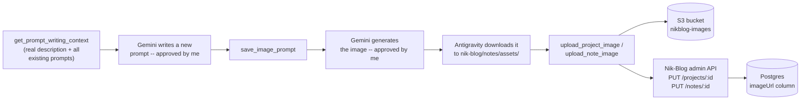

# nikblog-image-mcp

A real MCP (Model Context Protocol) server that closes the manual work in how I get a cover image onto Nik-Blog — from writing the Gemini prompt to the image landing live on the site. Started 2026-10-21, core pipeline complete and proven on a real production image as of 2026-10-22. I wrote the code myself, with syntax/logic explained step by step rather than generated for me — the notes under `notes/` track the real build, bugs included, not a cleaned-up version.

**Live use:** [career-watch-mcp](https://blog-tw4c.onrender.com/projects/career-watch-mcp)'s cover image was generated, approved, and uploaded through this exact pipeline. See [note 04](notes/04-first-real-cover-image-end-to-end.md).

## The problem this solves

Giving a project or note a cover image used to mean: write a Gemini image prompt by hand (copying the site's noir+copper style from memory), generate it in Antigravity, download the file, open the Nik-Blog admin panel, and upload it manually through the form. Every one of those steps but the creative one — actually picking what the image should look like — is now a tool call instead of something I do by hand.

## What it does



Six tools:
- `list_projects` / `list_notes` — titles + ids + whether each already has an image
- `get_prompt_writing_context(project_id)` — the project's real description plus the full text of every existing `gemini-prompt-*.md`, so a new prompt matches the established style and doesn't repeat a visual metaphor already used elsewhere
- `save_image_prompt(project_id, prompt_markdown)` — writes a new prompt to `nik-blog/notes/assets/gemini-prompt-<slug>.md`, matching the existing naming convention
- `upload_project_image(project_id, local_image_path, overwrite=False, confirmed=False)` / `upload_note_image(note_id, local_image_path, overwrite=False, confirmed=False)` — reads the file, uploads it to S3, then sets the `imageUrl` directly through Nik-Blog's own admin API. Refuses to replace an existing image unless `overwrite` is explicitly `True`. Two-step: a call with `confirmed=False` only previews what would happen — nothing uploads until a second call with `confirmed=True`.

No manual copy-paste anywhere in this flow — writing the prompt file, uploading to S3, and authenticating to Nik-Blog's admin API to set the image URL all happen inside the tools, not by me. The only two things that stay manual, on purpose, are approving the prompt text and approving the generated image.

## Why it's designed this way

- **A local file path, not base64.** Antigravity downloads the generated image to disk before I'd ever hand it to a tool, so the tool just needs a path — passing the raw image bytes base64-encoded through the MCP protocol would be ~33% heavier for no real benefit.
- **A dedicated, least-privilege IAM user**, separate from Nik-Blog's own backend credentials (`nikblog-backend`). This repo is going to be public, so it gets its own scoped AWS access — `s3:PutObject` + `s3:DeleteObject`, only on the `nikblog-images` bucket, nothing else in the account.
- **Reuses Nik-Blog's existing auth, doesn't invent new auth.** `requireAuth` on the Nik-Blog backend already accepts a `Bearer` token as a fallback for non-browser clients — this server logs in once and reuses that session instead of building a separate auth mechanism.
- **The overwrite guard lives in the tool, not in my memory.** `list_projects`/`list_notes` report whether a project or note already has an image, and `upload_project_image`/`upload_note_image` check that themselves before writing — so an existing cover can't get silently replaced by a mistake, even if the calling agent "forgets" to check first.
- **A second, structural confirmation gate.** The calling client (Antigravity) already shows its own approval dialog before any tool call, but that's the client's behavior, not something this server controls. So the upload tools require their own explicit `confirmed=True` on a second call — a first call only previews what would happen, nothing is written.

## What's built and verified

All six tools are complete. Verified at three separate levels, not just one:

1. **Direct Python calls**, against the real, live Nik-Blog API and real S3 — login, `list_projects`/`list_notes`, the overwrite guard (correctly refused on `Fragments`, which already had an image), the `confirmed` preview/execute split, and a real upload with every other field (title/description/tech_stack/github_url) confirmed intact afterward. See [note 02](notes/02-the-two-tools-and-a-real-bug.md).
2. **Connected to Antigravity for real, over the actual MCP protocol** — not just direct calls. All 6 tools discovered; `list_projects` called live through Antigravity.
3. **A full real production run**: `career-watch-mcp`'s actual cover image, written, approved, generated, approved again, and uploaded through this exact pipeline — nothing hypothetical. See [note 04](notes/04-first-real-cover-image-end-to-end.md).

**A real bug found and fixed before it could do damage:** `PUT /projects/:id` and `PUT /notes/:id` fully replace the row, not a partial update — caught by reading `projectService.js`/`noteService.js` directly, before writing the client code. `update_project_image`/`update_note_image` now read the current record first and send every field back unchanged except the image.

**Not built:** deciding whether to also delete the previous image's S3 object on overwrite (currently left as an unused but harmless orphan — a deliberate choice, not an oversight, see [note 00](notes/00-why-this-and-the-architecture.md)).

## Setup

```bash
python3 -m venv venv
source venv/bin/activate
pip install -r requirements.txt
```

`.env` needs:
```
NIKBLOG_API_URL=https://nik-blog.onrender.com
NIKBLOG_ADMIN_EMAIL=...
NIKBLOG_ADMIN_PASSWORD=...
NIKBLOG_REPO_PATH=/absolute/path/to/nik-blog
AWS_ACCESS_KEY_ID=...
AWS_SECRET_ACCESS_KEY=...
AWS_REGION=ca-central-1
S3_BUCKET_NAME=nikblog-images
```

## Running it

```bash
cd src
python3 server.py
```

Connect it to Antigravity via `~/.gemini/config/mcp_config.json`:

```json
{
  "mcpServers": {
    "nikblog-image-mcp": {
      "command": "/absolute/path/to/nikblog-image-mcp/venv/bin/python",
      "args": ["/absolute/path/to/nikblog-image-mcp/src/server.py"]
    }
  }
}
```

## Notes

- [`00-why-this-and-the-architecture.md`](notes/00-why-this-and-the-architecture.md) — the problem, the architecture, reading Nik-Blog's real backend code before designing anything, the dedicated IAM user, and a design decision walked back (delete vs. keep the old image on overwrite)
- [`01-s3-and-the-upload-function.md`](notes/01-s3-and-the-upload-function.md) — S3/boto3 basics and writing `upload_image`, with real mistakes caught along the way
- [`02-the-two-tools-and-a-real-bug.md`](notes/02-the-two-tools-and-a-real-bug.md) — the upload tools, the full-replace bug, the overwrite guard, and the `confirmed` two-step gate
- [`03-prompt-writing-tools-and-the-full-workflow.md`](notes/03-prompt-writing-tools-and-the-full-workflow.md) — `get_prompt_writing_context`/`save_image_prompt`, and the complete reusable Antigravity workflow prompt
- [`04-first-real-cover-image-end-to-end.md`](notes/04-first-real-cover-image-end-to-end.md) — the first real, non-test run, start to finish

## License

Not yet decided — will be added before this is made public.
