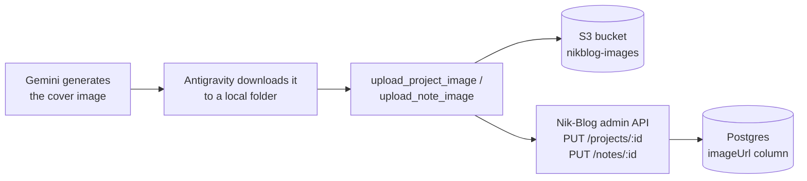

# nikblog-image-mcp

A real MCP (Model Context Protocol) server that closes the last manual step in how I get a cover image onto Nik-Blog. Started 2026-10-21. In progress — I'm writing the code myself, not having it written for me, so this README tracks what's actually built as it gets built, not what's planned.

## The problem this solves

Right now, giving a project or note a cover image means: write a Gemini image prompt by hand, generate it in Antigravity, download the file, open the Nik-Blog admin panel, and upload it manually through the form. That last step is the only one that doesn't need to be manual — Antigravity (which already runs on Gemini models) can call a tool directly instead of me doing the upload by hand every time.

## What it will do

Four tools, each doing one job:
- `list_projects` — titles + ids + whether each already has an image
- `list_notes` — same, for notes
- `upload_project_image(project_id, local_image_path, overwrite=False)` — reads the file, uploads it to S3, then sets that project's `imageUrl` directly through Nik-Blog's own admin API. Refuses to replace an existing image unless `overwrite` is explicitly `True`.
- `upload_note_image(note_id, local_image_path, overwrite=False)` — same, for notes.

No manual copy-paste of a URL anywhere in this flow — the last step (authenticating to Nik-Blog's admin API and writing the image URL to the database) happens inside the tool, not by me.

## Why it's designed this way

- **A local file path, not base64.** Antigravity downloads the generated image to disk before I'd ever hand it to a tool, so the tool just needs a path — passing the raw image bytes base64-encoded through the MCP protocol would be ~33% heavier for no real benefit.
- **A dedicated, least-privilege IAM user**, separate from Nik-Blog's own backend credentials (`nikblog-backend`). This repo is going to be public, so it gets its own scoped AWS access — `s3:PutObject` + `s3:DeleteObject`, only on the `nikblog-images` bucket, nothing else in the account.
- **Reuses Nik-Blog's existing auth, doesn't invent new auth.** `requireAuth` on the Nik-Blog backend already accepts a `Bearer` token as a fallback for non-browser clients — this server logs in once and reuses that session instead of building a separate auth mechanism.
- **The overwrite guard lives in the tool, not in my memory.** `list_projects`/`list_notes` report whether a project or note already has an image, and `upload_project_image`/`upload_note_image` check that themselves before writing — so an existing cover can't get silently replaced by a mistake, even if the calling agent "forgets" to check first.

## What's actually built right now

Nothing yet — architecture and AWS setup only. This section gets filled in as real, tested code lands, the same way every other project's README here does.

**Done so far:**
- Read Nik-Blog's real backend code (not guessed) to confirm the upload flow, the `imageUrl` field already accepted by the project/note update endpoints, and the `Bearer`-token auth fallback.
- Dedicated IAM user (`nikblog-image-mcp`) created on AWS, with a customer-managed policy (`NikblogImageMcpS3Write`) scoped to `s3:PutObject` + `s3:DeleteObject` on `nikblog-images/*` only.

## Notes

Build notes live under [`notes/`](notes/), numbered as they're written.

## License

Not yet decided — will be added before this is made public.
