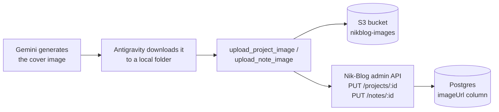

# 00 — Why this project, and how it's going to work

I already had two MCP servers: nikblog-mcp (read-only, exposes my portfolio as tools) and career-watch-mcp (write operations, job-search findings). This third one closes a real, repeated manual step instead of being practice for its own sake.

## The actual problem

Giving a Nik-Blog project or note a cover image is five manual steps: write a Gemini image prompt, generate it in Antigravity, download the file, open the admin panel, upload it through the form. The first four steps genuinely need a human (choosing what the image should look like is my call, not something to automate away). The fifth one — moving a file from my disk into the right place — doesn't need me at all.

## The architecture

Three pieces, each with one job:
- `s3_uploader.py` — reads a local file, uploads it to S3, hands back the public URL.
- `nikblog_client.py` — logs into Nik-Blog's own admin API once, keeps the session, exposes the calls the tools need (list projects/notes, update an image URL).
- `server.py` — the MCP server itself, wiring both of the above into tools an agent can call.

## Why I read the real Nik-Blog code before designing anything

Before deciding how this server should work, I went into the actual nik-blog repo and checked, instead of assuming:

- **The upload flow**: `multer` buffers the file in memory → `s3Service.uploadImage()` → the `nikblog-images` bucket, with a random filename (collision-safe, doesn't leak the original local filename).
- **A real discovery**: `projectsController.js` and `notesController.js` already accept a plain `imageUrl` string on `PUT /projects/:id` / `PUT /notes/:id` — even though the admin UI's form only exposes a file-browse input. The backend doesn't require going through the upload endpoint at all; it just needs the right string in the right field.
- **Another real discovery**: `requireAuth` already falls back to an `Authorization: Bearer <token>` header when there's no cookie — built, per its own comment, "for how curl/a future non-browser client authenticates." That's exactly this project.

Both of those meant the full loop — upload image, then point the project/note at it — was already possible through Nik-Blog's existing API, with zero changes needed to Nik-Blog itself.

## The AWS decision: a dedicated IAM user, not reusing the app's own

Nik-Blog's backend already has an IAM user (`nikblog-backend`) scoped to `s3:PutObject`/`s3:DeleteObject` on `nikblog-images/*`. I could have reused those credentials here. I didn't, for one real reason: this repo is going to be public, and credentials for one project's live backend have no business sitting in a `.env` for a separate, unrelated repo — even a gitignored one. A leaked or misconfigured `.env` in this project should never be able to touch the actual production app's access.

So: a new IAM user, `nikblog-image-mcp`, with its own customer-managed policy (`NikblogImageMcpS3Write`), scoped to exactly the same two actions on the same one bucket — same blast radius as the app's own user, but a completely separate credential.

## A design decision I walked back: delete vs. keep the old image

My first instinct when "overwriting" a project's image was to also delete the old S3 object, so the bucket doesn't fill up with orphaned files. I reconsidered: S3 storage for a few dozen images costs a few cents a month at most, and deleting is irreversible while leaving an unused file costs nothing real. So the policy still includes `s3:DeleteObject` in case it's useful later, but the actual upload tool's current design never calls it — "overwrite" means uploading a new image and repointing `imageUrl`, not destroying the old object.

## The overwrite guard — enforced by the tool, not by memory

`list_projects`/`list_notes` report whether a project or note already has an image. `upload_project_image`/`upload_note_image` check that themselves before writing, and refuse unless `overwrite=True` is passed explicitly. Same philosophy as career-watch-mcp's schema-enforced `job_url`: the rule lives in the code the tool runs, not in something the calling agent has to remember to check.

## Local file path, not base64

Antigravity downloads the generated image to disk before any tool call happens, so the simplest and most honest design is a tool that takes a file path, not one that expects raw image bytes passed through the MCP protocol — base64-encoding a binary file for transport adds roughly a third to its size for no benefit here, and isn't how the image actually reaches me anyway.
