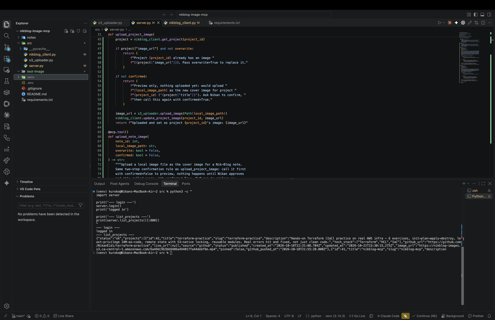
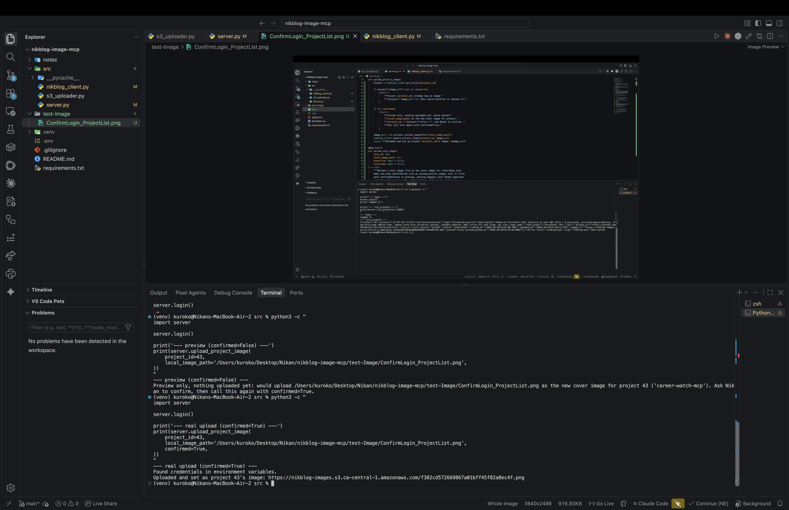

# 02 — Writing the upload tools, a real full-replace bug, and the confirmation gate

## Two more client functions, before the tools themselves

`nikblog_client.py` needed `get_project`/`get_note` (read one record) and `update_project_image`/`update_note_image` (write just the image) before `server.py` could do anything useful with them.

## A real bug I caught by reading the backend code, not by running it

My first version of `update_project_image` sent only `{"imageUrl": ...}` to `PUT /projects/:id`. Before testing it, I went and read `projectService.js`:

```js
function updateProject(id, { title, description, techStack, githubUrl, liveUrl, imageUrl }) {
  return pool.query(
    `UPDATE projects
     SET title = $1, description = $2, tech_stack = $3, github_url = $4, live_url = $5, image_url = $6, updated_at = NOW()
     WHERE id = $7`,
    [title, description, techStack, githubUrl, liveUrl, imageUrl || null, id]
  );
}
```

That `UPDATE` sets every column, every time — it's a full replace, not a `PATCH`-style partial update. Sending only `imageUrl` would have sent `title`/`description`/`techStack`/`githubUrl`/`liveUrl` as `undefined`, and the database would have wiped them to `NULL`. Same thing for `noteService.js`'s `updateNote`.

Fixed by having `update_project_image` read the current project first, then send every field back unchanged except `image_url`:

```python
def update_project_image(project_id: int, image_url: str) -> None:
    project = get_project(project_id)
    response = session.put(
        f"{os.environ['NIKBLOG_API_URL']}/projects/{project_id}",
        json={
            "title": project["title"],
            "description": project["description"],
            "techStack": project["tech_stack"],
            "githubUrl": project["github_url"],
            "liveUrl": project["live_url"],
            "imageUrl": image_url,
        },
    )
    response.raise_for_status()
```

This is the kind of bug that only shows up once, in production, on a project whose description I'd actually want back — reading the real backend code before writing the client was the only reason it didn't.

## The overwrite guard

`upload_project_image`/`upload_note_image` read the record first and check `image_url`. If it's already set and the caller didn't pass `overwrite=True`, the tool refuses and explains why instead of silently replacing a cover I might still want:

```python
if project["image_url"] and not overwrite:
    return (
        f"Project {project_id} already has an image "
        f"({project['image_url']}). Pass overwrite=True to replace it."
    )
```

## A second guard, added after a real conversation about it

Antigravity already shows an approval dialog before any tool call — but that's the client's behavior, not something this server controls or can rely on. Nikan asked for the confirmation to live in the tool itself, not just in whatever UI happens to be calling it. So both upload tools now take a `confirmed: bool = False` parameter:

```python
if not confirmed:
    return (
        f"Preview only, nothing uploaded yet: would upload "
        f"{local_image_path} as the new cover image for project "
        f"{project_id} ('{project['title']}'). Ask Nikan to confirm, "
        f"then call this again with confirmed=True."
    )
```

Called once, it only previews — no S3 call, no database write. Only a second call with `confirmed=True` actually uploads. This makes the confirmation step structural, the same way the overwrite guard and career-watch-mcp's required `job_url` are: enforced by the function itself, not something a calling agent has to remember to do.

## Verified end to end, on real data

Logged in for real, then ran `list_projects` against the live API:



Tested the overwrite guard against a project that already has one (`Fragments`, id 14) — it correctly refused instead of uploading:

```
Project 14 already has an image (https://nikblog-images.s3.ca-central-1.amazonaws.com/987a8a4...mp4). Pass overwrite=True to replace it.
```

Then ran the real two-step flow against `career-watch-mcp` (id 43), a project with no image yet. First the preview call (`confirmed=False`) — nothing happened:

```
Preview only, nothing uploaded yet: would upload .../test-image.png as the new cover image for project 43 ('career-watch-mcp'). Ask Nikan to confirm, then call this again with confirmed=True.
```

Then the real call (`confirmed=True`) — a real object landed in S3, and the project's `image_url` was set:

```
Uploaded and set as project 43's image: https://nikblog-images.s3.ca-central-1.amazonaws.com/f382cd572669867a01bff45f82a8ec4f.png
```

Confirmed in the admin panel itself, not just by trusting the function's return value — the project now shows a "Remove Image" option, meaning the real row in the real database actually changed:



And re-read the project straight from the API afterward to confirm `title`/`description`/`tech_stack`/`github_url` were still intact — the full-replace bug fix actually held under a real call, not just in theory.
