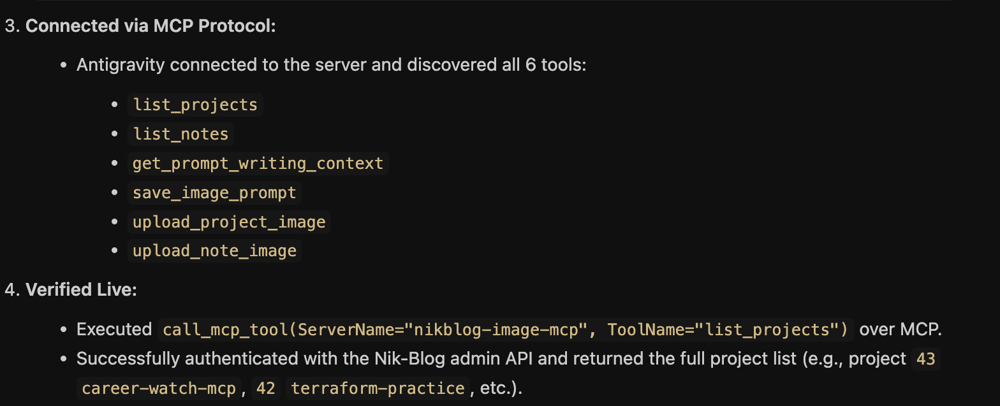

# 03 — Writing the image prompt itself, and the full reusable workflow

The first four tools closed the upload step. They didn't touch the step before it — writing the actual Gemini image prompt, which I was still doing by hand every time, copying the noir+copper style from memory instead of really matching it.

## Two more tools

**`get_prompt_writing_context(project_id)`** — reads the target project's real title and description, plus the full text of every existing `gemini-prompt-*.md` file in `nik-blog/notes/assets/`. Returns both as one string. The point of handing over every existing prompt, not just one or two as examples, is twofold: matching the exact fixed language (intro, Style paragraph, avoid-list boilerplate) and avoiding a "Subject" visual metaphor that's already been used for a different project — I can't check that myself without reading all of them, so neither should the agent have to.

**`save_image_prompt(project_id, prompt_markdown)`** — looks up the project's `slug`, writes the given markdown to `nik-blog/notes/assets/gemini-prompt-<slug>.md`, matching the naming convention every existing prompt file already follows.

Both needed a new piece of config: `NIKBLOG_REPO_PATH`, the real local path to the `nik-blog` repo on disk — different from `NIKBLOG_API_URL`, since this server reads and writes real files in that repo directly, not through the API. The prompt files aren't data in Postgres; they're just markdown sitting in a git repo I commit and push myself.

## Verified live

Called `get_prompt_writing_context(43)` for `career-watch-mcp` (unpublished at the time) — got back its real description plus all 12 existing prompts concatenated, ~28.6K characters. Then wrote a real prompt for it, matching the established template, with a new visual metaphor (two unequal enclosures connected by one gated channel, for the project's actual privacy-by-separation design — not reused from any other project's motif), and saved it with `save_image_prompt`. Confirmed the file landed at the right path with the right content. Deleted it afterward since it was a real test, not the prompt I actually want to use when I generate this project's real cover.

## The full reusable workflow, end to end

This is what I now paste into Antigravity to generate a new cover image, covering every step from picking the project to the image actually landing on the live site — with two separate, explicit approval points (the prompt text, then the generated image), not one blanket "proceed":

```
Generate a new cover image for the project [Project Name].

1. Call `list_projects` to find its `project_id`.
2. Call `get_prompt_writing_context(project_id)` to get its real description and every existing image prompt.
3. Write a new Gemini image prompt for this project, matching the exact noir+copper style and structure of the existing ones — same fixed intro/Style/avoid-list language, with a new "Subject" visual metaphor tied to what this project actually does, not reused from another project. Show me the full prompt text before doing anything else.
4. Once I approve the prompt text: call `save_image_prompt(project_id, prompt_markdown)` to save it.
5. Generate the image from that prompt and show it to me. Do not go further until I explicitly approve the image — don't download or upload anything yet.
6. Once I approve the image: download it into `~/Desktop/Nikan/nik-blog/notes/assets/` (same folder as the prompt files).
7. Call `upload_project_image(project_id, local_image_path)` with `confirmed` left as `False` first, show me the preview.
8. Only after I confirm again: call it a second time with `confirmed=True`.

Do not pass `overwrite=True` unless I explicitly say to replace an existing image.
```

## Connected to Antigravity for real

Not just tested by calling the functions directly in Python — registered in `~/.gemini/config/mcp_config.json`, restarted, and connected over the actual MCP protocol. Antigravity discovered all 6 tools and called `list_projects` live, authenticating against the real Nik-Blog admin API and returning the real project list:



(One detour along the way: Antigravity's own ad-hoc shell-based debugging ran `server.py` inside a network-sandboxed environment with no DNS resolution, which looked like a server bug at first — it wasn't. That sandbox is separate from the actual process Antigravity launches when connecting over the real protocol.)

Two approval points instead of one, matching how the tools themselves were designed: approving a prompt isn't the same thing as approving a specific generated image, and collapsing them into one "yes" would mean the actual image never gets looked at before it's live.
