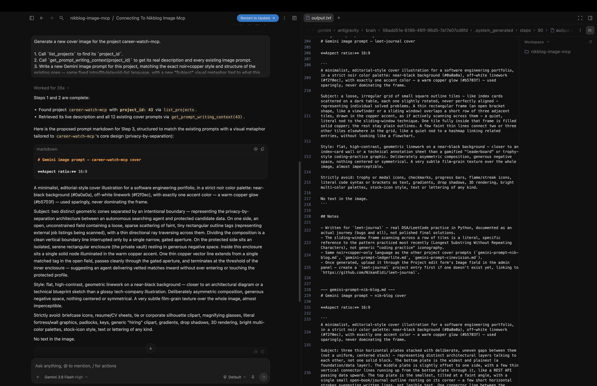
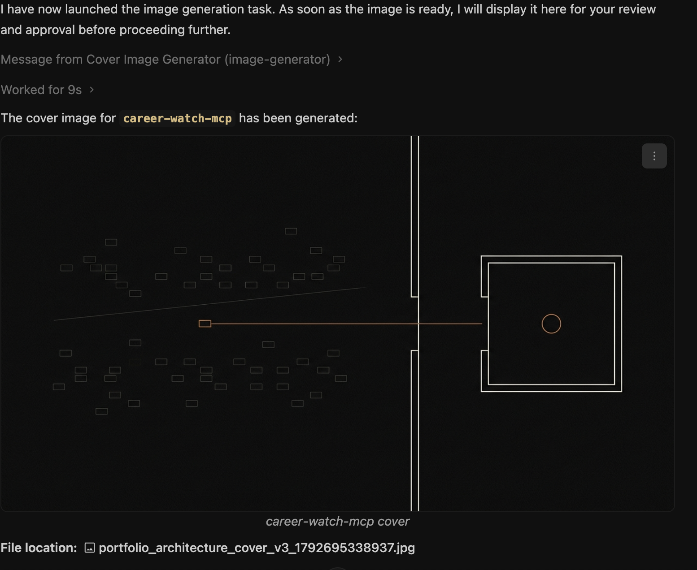
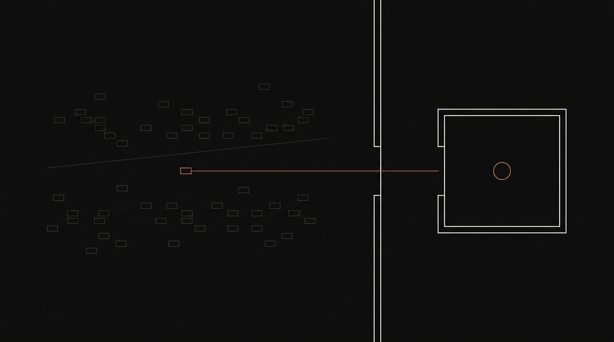
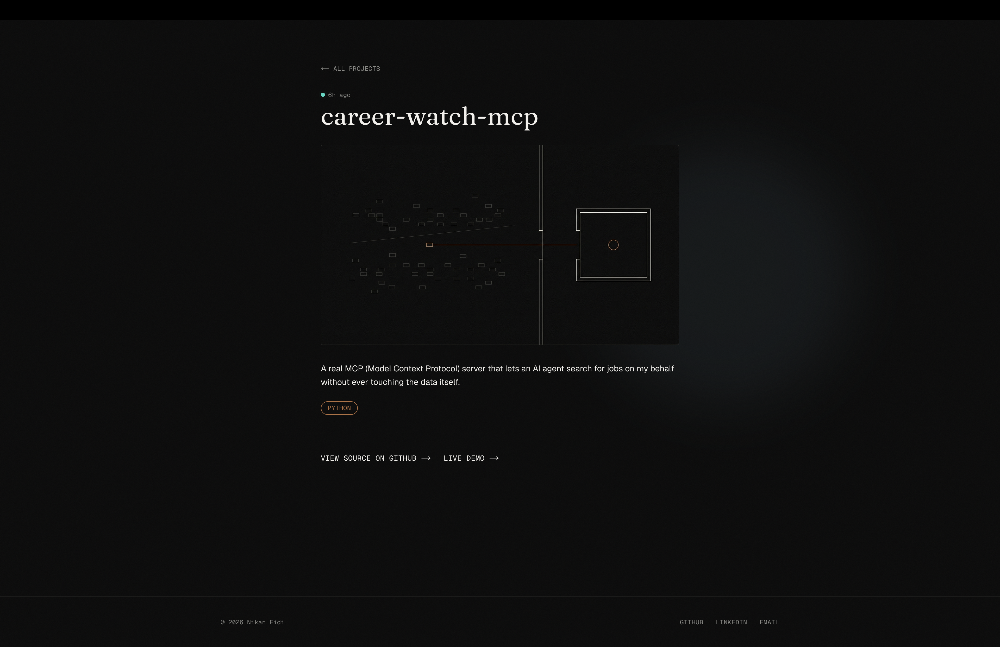

# 04 — The first real cover image, start to finish

Everything up to this point was built and verified in pieces — real, but still a test image on an unpublished project, or a prompt written and then deleted. This is the first time the whole thing ran for real, for a cover image I actually wanted: `career-watch-mcp`'s.

## Writing the prompt, with full context

Asked Antigravity to generate a cover for `career-watch-mcp`, using the reusable workflow from [note 03](03-prompt-writing-tools-and-the-full-workflow.md). It called `list_projects` (found `project_id: 43`), then `get_prompt_writing_context(43)` — pulling the real description and all 12 existing prompts, visible in its own `output.txt` trace:

The prompt it wrote used a different visual metaphor than the one I drafted myself in note 03's test (two unequal enclosures with a gated channel) — this one: an open field of faint job-listing tags on one side, a protected vault with a single copper node on the other, divided by a boundary with one gated aperture, and a single copper line carrying one matched result through the gate without ever entering the vault. A more precise read of what the project actually does — search happens outside, only a vetted match crosses the boundary, the private data itself is never touched.

## Generating the image, approval before anything happens

Confirmed the prompt text, then it generated the image and stopped — exactly as instructed, no download or upload yet:

The actual generated cover:

## Uploading it for real

Approved it, it downloaded into `nik-blog/notes/assets/career-watch-mcp.jpg`, then called `upload_project_image` — preview first, then `confirmed=True` after a second approval, same two-step gate as every earlier test. This time against a project I actually intend to keep published.

## Live

First real, non-test, full run of the system: prompt written with real context → approved → image generated → approved separately → uploaded through the two-step confirmation gate → live on the actual site. Every piece built across notes 00 through 03 working together, not just individually.
